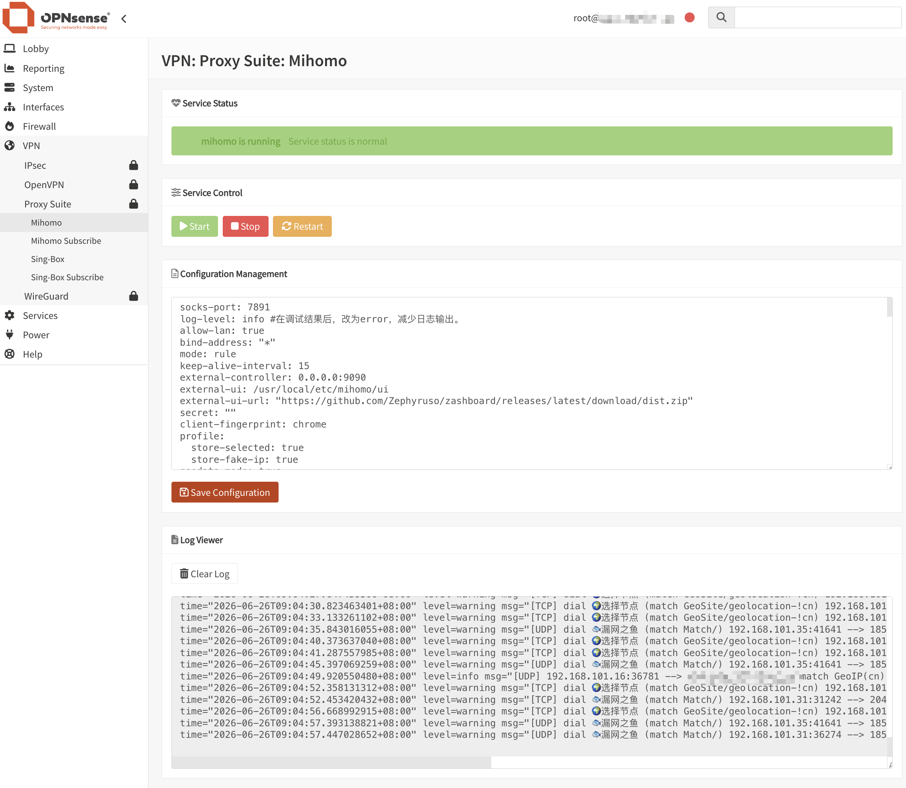

<div align="center">
  <a href="README.md">中文</a> |
  <a href="README.US.md">English</a>
</div>

# Mihomo for OPNsense


Mihomo, formerly Clash Meta, is a high-performance open source proxy core compatible with Clash configuration files. It provides rule-based routing, DNS handling, load balancing, and transparent proxy support.

This project packages Mihomo as an OPNsense plugin so it can run on OPNsense and provide transparent proxy functionality through the OPNsense WebGUI.

Tested on:

- OPNsense 26.1.9



## Binary Supply Chain

The project uses **only the official static binary from [MetaCubeX](https://github.com/MetaCubeX/mihomo)**, downloaded directly from the official GitHub release:

```text
https://github.com/MetaCubeX/mihomo/releases/download/v{VERSION}/mihomo-freebsd-amd64-v{VERSION}.gz
```

The version is pinned in `mihomo-version.env`. Every download is verified against a **SHA256 strong hash** — any mismatch aborts the build immediately. There are no third-party binary forks or unofficial mirrors in the supply chain.

## Panel Features (1.0.5)

- **Subscription management**: The subscription URL lives only in the MVC model and is strictly validated server-side (https only; quotes, backticks, control characters, whitespace and `$(` are rejected). `sub/env` is generated by a configd action with POSIX single-quote escaping (0600). Auto-update intervals of 6h/12h/24h register idempotently through the OPNsense Cron model API. "Update now" runs detached and the UI polls `last-sub-update.json` for time / node count / result.
- **Transparent proxy toggle**: Switching the transport mode to transparent registers a dedicated `mihomo-transport` PF anchor (head + quick, rebuilt on every filter reload — no self-healing window). `transport_manager.sh` only ever runs `pfctl -a ... -f/-F` against that anchor and never touches the main ruleset. Bypass destinations (self addresses, gateway, RFC1918, multicast/broadcast, DHCP) are excluded via a `<mihomo_bypass>` table, so unmatched traffic simply falls through to the administrator's own policy. hev-socks5-tunnel is owned by the plugin's `mihomo_hev` rc script (wrapped in `script(1)` for its pty requirement, stopped strictly by pid — no global pkill). The watchdog flushes the anchor on failure to restore direct connectivity and re-applies it idempotently on recovery; service stop/fail-open tear the transport down as well, so traffic can never be routed into a dead port. Enable runs with SSH-liveness assertions and rolls back on failure.
- **Persistent custom rules**: Whitelisted rule types (DOMAIN / DOMAIN-SUFFIX / DOMAIN-KEYWORD / IP-CIDR / IP-CIDR6 / GEOIP / GEOSITE / DST-PORT) are validated line by line (max 200 lines / 32 KiB; quotes, braces, brackets, tabs rejected); targets are limited to DIRECT / REJECT / REJECT-DROP plus the policy groups that actually exist in the template. Valid rules are stored in `custom-rules.txt` (0600), injected at the top of `rules:` during composition, and gated by `mihomo -t` — an invalid rule never touches the running configuration; errors are mapped back to custom-rules line numbers. The node cache (`subscription-cache.yaml`) allows rules to be applied offline; if the cache is missing a full subscription update is triggered once.
- **Upgrade protection**: `+PRE_INSTALL` stops the transport and the process (SIGTERM grace, then SIGKILL) and snapshots config.yaml / sub/env / custom-rules.txt / secret.key / template_config.yaml to `/var/db/os-mihomo/pre-upgrade/` (0600). `+POST_INSTALL` restores them strictly (missing files fall back to bundled samples, the secret is only generated when absent, the transport layer is re-applied per model after the health gate). Upgrades and reinstalls no longer lose the subscription.
- **LAN exposure (off by default)**: mixed-port 7890 stays bound to `127.0.0.1` by default. When explicitly enabled in the panel it binds `0.0.0.0` with mandatory authentication (password reuses the API secret) and `lan-allowed-ips` restricted to the LAN subnet; the health gate probes the LAN binding accordingly. An unauthenticated LAN-open proxy is not offered.

## One-Command Install (Transparent Proxy)

The subscription URL is the only required input; everything else (env write, model/transport switch, cron registration for auto-update and the watchdog, subscription pull, final health report) is automated:

```sh
# Option A: deploy during install (pkg passes environment to its scripts)
MIHOMO_SETUP_URL='https://your-subscription-url' pkg add os-mihomo-1.0.5.pkg

# Option B: one command after install (re-runnable to change settings)
sh /usr/local/etc/mihomo/setup.sh 'https://your-subscription-url' transparent
```

Optional: `MIHOMO_SETUP_TRANSPORT` (transparent/proxy, default transparent) and `MIHOMO_SETUP_INTERVAL` (o6h/o12h/o24h, default o24h). setup.sh is idempotent; switching to transparent registers the `mihomo-transport` anchor via filter reload and takes over hev (tun0), with the bypass table protecting management/SSH/WebGUI at all times.

## Security Features

- **Official supply chain**: MetaCubeX releases only (pinned v1.19.30 compatible), SHA256-verified on both the archive and the unpacked binary; the zashboard UI is pinned and bundled, with zero runtime downloads.
- **Atomic subscription updates**: https-only URLs, host-masked logs; composed configs are validated with `mihomo -t` before an atomic rename — a bad subscription can never overwrite a working configuration.
- **Secret never in argv**: A CSPRNG-generated 32-byte API secret is injected through the environment (`ENVIRON`) and rotated via 0600 temp sed scripts; the WebGUI always displays it masked.
- **Fail-Open bypass**: The watchdog probes process / API / DNS(1053) / socks(7891) and falls back to DIRECT; in transparent mode it also flushes the `mihomo-transport` anchor so LAN traffic reverts to the administrator's own policy.
- **Zero system intrusion**: Unbound is never touched; `/conf/config.xml` writes are limited to the `//OPNsense/mihomo` and `//OPNsense/cron` model nodes; PF involvement is limited to the plugin's own `mihomo-transport` anchor (pass/route-to only, block/reject forbidden) — the main ruleset is never modified.

## Notes

1. Only x86_64 / amd64 is currently supported.
2. After installation, no interface or firewall rule needs to be added manually. Edit the node information in the default configuration and use it directly.
3. After debugging is complete, set the log level to `error` to avoid excessive long-term logs.
4. The Clash API defaults to listening on `127.0.0.1:9090` (configurable in the panel) and is accessible via the built-in WebGUI panel. **Do not expose the API port to the WAN.**
5. mihomo's own TUN must stay disabled: FreeBSD has no sing-tun backend (issue #1157). In transparent mode the transport layer is hev-socks5-tunnel (`tun0`, requires the `if_tun` kernel module) owned by the plugin, plus the `mihomo-transport` PF anchor; in plain proxy mode neither is involved.
6. This package never modifies Unbound. Point your existing DNS chain (Unbound forwarding, AdGuardHome upstream, etc.) at `127.0.0.1:1053` to use the mihomo DNS listener.

## Install

Upload the package to OPNsense and run:

```sh
pkg add -f os-mihomo.pkg
```

After installation, refresh the OPNsense WebGUI and go to:

```text
VPN > Mihomo
```

## Uninstall

```sh
pkg delete os-mihomo
```

## Subscription Updates

Automatic subscription updates can be scheduled with Cron:

```text
System > Settings > Cron
```

Add a scheduled task and select:

```text
Renew mihomo Subscription
```

## Build

Build on Ubuntu/Debian or FreeBSD/OPNsense. Run:

```sh
bash scripts/build.sh
```

Output file:

```text
output/os-mihomo-*.pkg
```

Verify package integrity:

```sh
bash scripts/verify-package.sh
```

Inspect package metadata:

```sh
pkg info -F output/os-mihomo-*.pkg
```

## Common Commands

Service control:

```sh
service mihomo start
service mihomo stop
service mihomo status
service mihomo restart
service mihomo rcvar
```

View logs:

```sh
tail -f /var/log/mihomo.log
```

Check listening ports:

```sh
sockstat -4 -l | egrep ':53|:1053|:7891|:<API_PORT>'
```

Check the TUN interface:

```sh
ifconfig tun_mihomo
```

Check runtime firewall rules:

```sh
pfctl -sr | grep -E 'mihomo'
```

Inspect PF anchor details:

```sh
pfctl -a mihomo -sr
```

Check watchdog / Fail-Open status:

```sh
/usr/local/opnsense/scripts/mihomo/watchdog.sh status
```

## Troubleshooting

| Symptom | Steps |
|---|---|
| Proxy not connecting | `service mihomo status`; check `/var/log/mihomo.log` |
| DNS resolution failing | `dig @127.0.0.1 -p 1053 example.com`; verify Unbound forwarding state |
| API unreachable | API defaults to `127.0.0.1:9090` (configurable in the panel); access via the WebGUI panel or SSH tunnel, not directly from WAN |
| Subscription update fails | Verify target URL certificate validity; check `/var/log/mihomo-sub.log` |
| PF rules not applied | `pfctl -a mihomo -sr`; verify the anchor is loaded |
| Fail-Open triggered | Watchdog has switched to direct routing; see `/var/log/mihomo-watchdog.log` for the trigger reason |

## Credits

[MetaCubeX](https://github.com/MetaCubeX/mihomo)

## Disclaimer

> [!CAUTION]
> This is an unofficial plugin and is not supported by the OPNsense team. Use it at your own risk.
