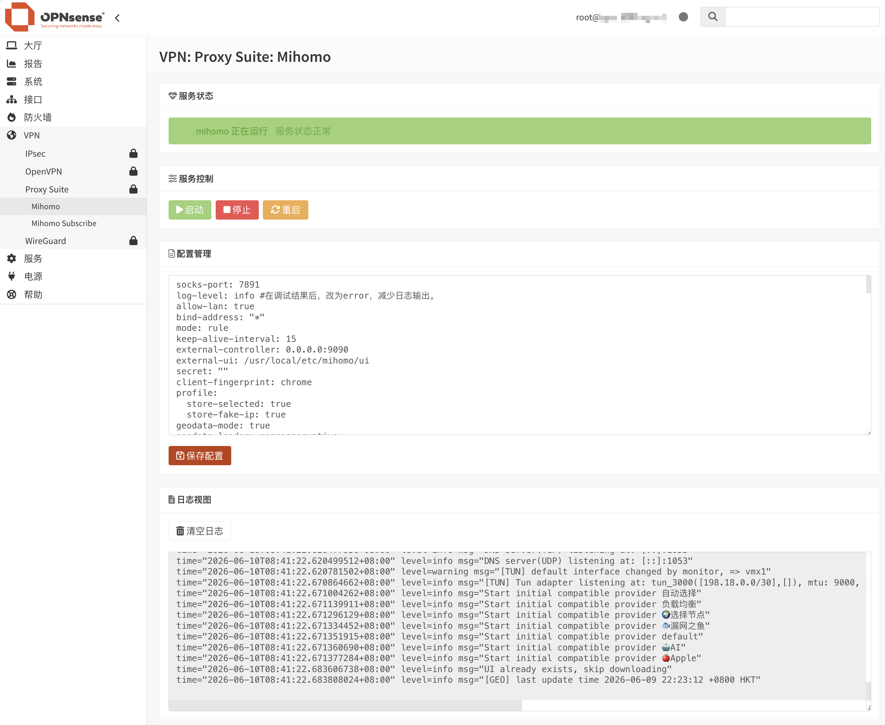

<div align="center">
  <a href="README.md">中文</a> |
  <a href="README.US.md">English</a>
</div>

# Mihomo for OPNsense


Mihomo（原 Clash Meta）是一款高性能、功能丰富的开源代理核心，兼容 Clash 配置格式，并在此基础上扩展了更多协议和高级功能，支持多种代理协议，提供灵活的规则分流、DNS 管理、负载均衡和透明代理功能。凭借其优秀的性能和广泛的兼容性，Mihomo 已成为构建现代网络代理和流量管理解决方案的重要工具之一。

本项目是一个用于 OPNsense 的 Mihomo 插件。v3 起以 **socks 核心模式**交付：mihomo 只负责代理与 DNS 解析，透明代理传输由路由器既有的 hev-socks5-tunnel + PF route-to 体系承担，插件不再修改 `/conf/config.xml`、PF 主规则集与 Unbound。

## 目标平台与验证状态

- 目标平台：OPNsense 26.7 / FreeBSD 15.1，amd64。
- 构建与静态回归在开发环境（Linux）完成，入口为 `tests/test_*.sh`；本仓库**不声明**已在某个具体 OPNsense 版本上完成端到端验收。
- 部署后请按本文「常用命令」与「故障排查」在目标机自检；生产上线前请在维护窗口内验证。



## 架构（socks 核心模式）

- **mihomo 仅作 socks 核心**：socks5 `127.0.0.1:7891`、DNS `127.0.0.1:1053`、RESTful API 默认 `127.0.0.1:9090`（可在面板配置绑定地址与端口）。所有监听默认均绑定本地回环。
- **传输层外置（1.0.5 起可选接管）**：透明代理由 hev-socks5-tunnel（`tun0`）+ PF `route-to` 承担；面板将传输模式切到 transparent 时，插件仅通过自有 `mihomo-transport` anchor（head+quick）下发 route-to 规则并接管 hev 进程，关回 proxy 模式即干净移除；任何情况下不触碰 PF 主规则集与 Unbound。
- **TUN 在 FreeBSD 不可用**：mihomo 的 sing-tun 后端没有 FreeBSD 实现，开启 TUN 后实测报 `configure tun interface: invalid argument`（见 [MetaCubeX/mihomo issue #1157](https://github.com/MetaCubeX/mihomo/issues/1157)）。因此 `config.yaml` 固定 `tun.enable: false`，**请勿开启**。
- **Fail-Open**：watchdog 以进程、API(9090)、DNS(1053)、socks(7891) 监听为健康判据；异常时停掉 mihomo 并切回直连，DNS 由上游 fallback 自然回退，主路由不会因代理故障断网。

## 面板化功能（1.0.5）

- **订阅管理**：订阅 URL 只存 MVC 模型并做服务端强校验（仅 https，显式拒绝引号、反引号、控制字符、空白与 `$(`）；`sub/env` 由 configd 动作生成（POSIX 单引号转义，0600）；支持 6h/12h/24h 自动更新（经 OPNsense Cron 模型注册，幂等）；「立即更新」异步触发，前端轮询 `/var/db/os-mihomo/last-sub-update.json` 展示时间/节点数/结果/错误摘要。
- **透明代理开关**：模型 `transport` 切到 transparent 时，`mihomo_firewall()` 注册 `mihomo-transport` anchor（每次 `filter reload` 自动重建引用，无自愈窗口）；`transport_manager.sh` 只对该 anchor 执行 `pfctl -a ... -f/-F`，永不 `pfctl -f` 主规则集。bypass 用 `<mihomo_bypass>` 表排除（本机自身地址、网关、RFC1918、组播/广播、DHCP），未匹配流量自然落回用户策略，零覆盖。hev-socks5-tunnel 由插件 `mihomo_hev` rc 接管（`script(1)` 伪终端包装、按 pid 停止、禁全局 pkill）。watchdog 判定不健康时清空 anchor 恢复直连，健康恢复后按模型幂等重挂；服务 stop/fail-open 同步收掉传输层，杜绝 route-to 进死端口黑洞。enable 全程 SSH 存活断言，失败即回退。
- **持久自定义规则**：白名单类型（DOMAIN/DOMAIN-SUFFIX/DOMAIN-KEYWORD/IP-CIDR/IP-CIDR6/GEOIP/GEOSITE/DST-PORT）逐行校验（≤200 行、≤32KB，禁引号/花括号/方括号/Tab 等），目标仅允许 DIRECT/REJECT/REJECT-DROP 与模板实际策略组；通过后写 `custom-rules.txt`（0600），订阅合成时插入 `rules:` 顶部，`mihomo -t` 校验失败则生产配置保持不变；报错映射回 custom-rules 行号。订阅节点缓存（`subscription-cache.yaml`）支撑规则应用时离线重组配置，缓存缺失自动降级触发一次在线更新。
- **升级配置保护**：`+PRE_INSTALL` 先停传输层与进程（SIGTERM 宽限→超时 SIGKILL），把 config.yaml/sub/env/custom-rules.txt/secret.key/template 快照到 `/var/db/os-mihomo/pre-upgrade/`（0600）；`+POST_INSTALL` 严格按「快照恢复→sample 兜底→secret 仅缺失时生成→健康门禁→按模型重挂传输层」执行，升级/重装不再丢订阅与密钥。
- **LAN 暴露（默认关闭）**：默认 mixed-port 7890 仅绑 `127.0.0.1`（本机代理）；面板显式开启后改绑 `0.0.0.0` 并强制 authentication（用户可配，密码复用 API secret）+ `lan-allowed-ips` 限定 LAN 网段，健康门禁同步改探测 LAN 绑定。无认证的局域网开放代理不做。

## 项目程序

项目直接使用 [MetaCubeX](https://github.com/MetaCubeX/mihomo) 官方发布的静态二进制文件，通过锁定版本号与 **SHA256 双重校验**（压缩包 + 解包后二进制）确保供应链完整性。构建脚本从以下官方地址下载：

```text
https://github.com/MetaCubeX/mihomo/releases/download/v1.19.30/mihomo-freebsd-amd64-compatible-v1.19.30.gz
```

版本 URL、文件名与两个 SHA256 均由 `src/os-mihomo/build/mihomo-version.env` 锁定。

仪表盘面板（zashboard）同样按版本锁定并随包内置，构建时下载并校验 SHA256 后解压到 `/usr/local/etc/mihomo/ui`，运行期不下载任何前端资源。

## 安全特性

- **官方供应链**：仅使用 MetaCubeX 官方 Release（当前锁定 v1.19.30 compatible），压缩包与解包二进制均做 SHA256 强校验，零第三方二进制依赖。
- **内置面板零运行期下载**：zashboard 随包内置（`external-ui` 指向本地目录，不配置 `external-ui-url`），避免运行期拉取任意前端资源。
- **Geo 数据手动更新**：默认 `geo-auto-update: false`，需要时经 Clash API 或手动替换 Geo 文件更新，避免后台自动下载。
- **Secret 不进 argv**：CSPRNG 生成 32 字节 API Secret，订阅注入与轮换通过环境变量（`ENVIRON`）和 0600 临时 sed 脚本完成，不出现在进程参数中；WebGUI 展示自动脱敏。
- **订阅原子更新**：订阅 URL 仅允许 `https://`，日志掩码到 host 级；合成配置先由 `mihomo -t` 校验，通过后才备份并原子替换 `config.yaml`，坏订阅永远不会覆盖生产配置。
- **API 安全与可配**：Clash API 默认绑定 `127.0.0.1:9090`，绑定地址与端口可在面板配置（非回环绑定强制有效 Secret），面板经 SSH 隧道或 WebGUI 访问，勿将 API 端口暴露到外网。
- **Fail-Open 故障旁路**：watchdog 巡检进程/API/DNS/socks 监听，异常时切回直连。
- **零系统侵入**：Unbound 永不触碰；`/conf/config.xml` 仅允许模型 API 写入 `//OPNsense/mihomo` 与 `//OPNsense/cron` 两个节点；PF 只允许自有 `mihomo-transport` anchor（只含 pass/route-to，禁止 block/reject），主规则集永不篡改。

## 一键安装（透明代理）

订阅 URL 是唯一必填项，其余全自动（订阅写入、模型/传输层切换、自动更新与 watchdog 定时任务注册、订阅拉取、终检报告）：

```sh
# 方式一：装包即部署（pkg 会把环境变量传给安装钩子）
MIHOMO_SETUP_URL='https://your-subscription-url' pkg add os-mihomo-1.0.5.pkg

# 方式二：装包后一条命令（也可随时重跑修改设置）
sh /usr/local/etc/mihomo/setup.sh 'https://your-subscription-url' transparent
```

可选参数：`MIHOMO_SETUP_TRANSPORT`（transparent/proxy，默认 transparent）、`MIHOMO_SETUP_INTERVAL`（o6h/o12h/o24h，默认 o24h）。setup.sh 幂等，重复执行等价于修改设置并重挂；transport 切 transparent 会经 filter reload 注册 `mihomo-transport` anchor 并接管 hev（tun0），全程 bypass 表保护管理口/SSH/WebGUI。

## 注意事项

1. 当前仅支持 x86_64 / amd64 平台。
2. mihomo 的 TUN 仍必须保持关闭（FreeBSD 无 sing-tun 实现）；透明代理传输在 transparent 模式下由插件托管的 hev-socks5-tunnel（`tun0`，需 `if_tun` 内核模块）+ `mihomo-transport` anchor 承担，proxy 模式下完全不涉及。
3. 安装调试完成后，将日志层级调整为 `error`，避免长期运行产生过多日志。
4. Clash API 默认监听 `127.0.0.1:9090`（可在面板配置），面板通过 WebGUI 或 SSH 隧道访问，**请勿将 API 端口暴露至外网**。
5. 必须保持 `tun.enable: false`：FreeBSD 无 sing-tun 实现，开启会导致启动失败（issue #1157）。
6. 插件不修改 Unbound。DNS 查询需要由上游（Unbound 或 AdGuardHome 等）转发到 `127.0.0.1:1053`，由运维按既有 DNS 架构配置。

## 安装命令

将安装包上传到 OPNsense 后执行：
```sh
pkg add -f os-mihomo.pkg
```
安装钩子会初始化 secret、启动服务，并在 30 秒内检查 `1053/7891/9090` 三个监听；若未就绪，详情写入 `/root/os-mihomo-install-warning.log`（不会自动改动 DNS/PF）。

安装完成后刷新 OPNsense WebGUI，进入：
```text
Services（服务） > Mihomo
```

## 面板访问（SSH 隧道）

面板已随包内置（zashboard）。在管理终端建立隧道：

```sh
ssh -L <API_PORT>:127.0.0.1:<API_PORT> root@<OPNsense_LAN_IP>
```

保持 SSH 会话，然后在浏览器打开：

```text
http://127.0.0.1:<API_PORT>/ui
```

> 注：`<API_PORT>` 默认为 `9090`，若在面板中调整了端口，请使用对应端口。

登录所需 Secret 可在插件界面查看（也可执行 `configctl mihomo secret-get`）。

## 卸载命令
```sh
pkg delete os-mihomo
```
卸载时用户配置目录会移动到 `/root/os-mihomo-removed-<时间戳>`，保留订阅、secret 与自定义配置。

## 订阅更新
自动更新订阅可通过 Cron 完成：
```text
转到 系统 > 设置 > 任务
```
添加定时任务，在命令项，找到以下命令并添加：
```sh
Renew mihomo Subscription
```

也可以手动执行：
```sh
configctl mihomo sub-update
tail -f /var/log/mihomo_sub.log
```

## 编译 pkg
在 Ubuntu/Debian 或 FreeBSD/OPNsense 主机上均可构建。运行：

```sh
bash scripts/build.sh
```

构建会校验 mihomo 二进制与 zashboard 的 SHA256，并把面板解压到包的 `usr/local/etc/mihomo/ui`。输出文件：

```text
output/os-mihomo-*.pkg
```
验证包完整性：
```sh
bash scripts/verify-package.sh
```
检查包元数据：
```sh
pkg info -F output/os-mihomo-*.pkg
```

## 常用命令

服务控制：
```sh
service mihomo start
service mihomo stop
service mihomo status
service mihomo restart
service mihomo rcvar
```

configd 动作：
```sh
configctl mihomo status
configctl mihomo system-status
configctl mihomo watchdog
configctl mihomo failopen "manual test"
configctl mihomo sub-update
```

查看日志：
```sh
tail -f /var/log/mihomo.log
tail -f /var/log/mihomo_sub.log
tail -f /var/log/mihomo_watchdog.log
```

检查监听端口：
```sh
sockstat -4 -l | egrep ':1053|:7891|:<API_PORT>'
```

检查 socks 监听：
```sh
sockstat -4 -l -p 7891
```

检查 DNS 解析：
```sh
dig @127.0.0.1 -p 1053 example.com
```

检查 API（需替换 Secret 与端口，默认 9090）：
```sh
curl -s -H "Authorization: Bearer <secret>" http://127.0.0.1:<API_PORT>/version
```

检查传输层（既有体系，不属本插件管理）：
```sh
ifconfig tun0
pfctl -sr | grep route-to
```

## 故障排查（Troubleshooting）

| 现象 | 排查步骤 |
|---|---|
| 代理无法连接 | `service mihomo status`；`tail -f /var/log/mihomo.log`；`sockstat -4 -l -p 7891` |
| DNS 解析异常 | `dig @127.0.0.1 -p 1053 example.com`；确认上游（Unbound/AGH）已转发到 `127.0.0.1:1053`；插件不修改 Unbound |
| API / 面板无法访问 | API 默认监听 `127.0.0.1:9090`（可在面板配置），使用 WebGUI 或 SSH 隧道访问 `http://127.0.0.1:<API_PORT>/ui`，勿从外网直连 |
| 订阅更新失败 | 检查目标 URL 是否为 `https://` 且证书有效；`tail -f /var/log/mihomo_sub.log`；校验失败时生产配置保持不变 |
| socks 监听缺失 | `sockstat -4 -l -p 7891`；`service mihomo restart`；查看 `/var/log/mihomo.log` |
| 透明代理不通 | 检查 hev-socks5-tunnel 的 `tun0` 与 PF `route-to` 规则（既有传输层）；本插件不创建 TUN、不下发 PF 规则 |
| 开启 TUN 后启动失败 | FreeBSD 无 sing-tun 实现（[issue #1157](https://github.com/MetaCubeX/mihomo/issues/1157)），保持 `tun.enable: false` |
| Fail-Open 触发 | 查看 `/var/log/mihomo_watchdog.log` 了解触发原因；`configctl mihomo status` 确认已切回直连 |

## 致谢
[MetaCubeX](https://github.com/MetaCubeX/mihomo)

## 免责声明
> [!CAUTION]
> 非官方插件，无 OPNsense 团队支持。使用者自行承担一切后果。
